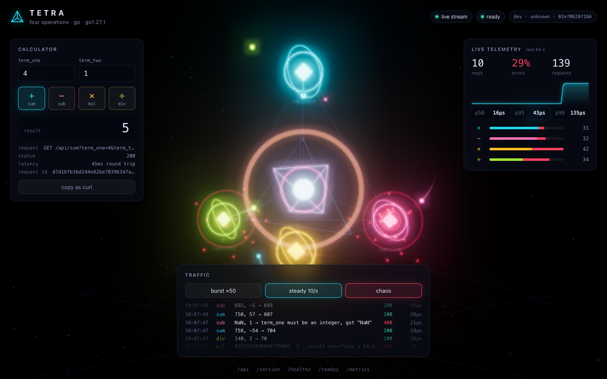

# Tetra · Go

[](https://github.com/giovannirco/tetra-go/actions/workflows/ci.yml)

A four-operation arithmetic API, built the way I'd ship a production service: tests with coverage, structured logs, Prometheus metrics with SLO alerts, health probes, graceful shutdown, a hardened container, and a three.js UI that draws every request as it happens.

It is one of four implementations of the same [contract](docs/CONTRACT.md): **Go** (this repo), [Ruby](https://github.com/giovannirco/tetra-ruby), [Node.js](https://github.com/giovannirco/tetra-node) and [TypeScript](https://github.com/giovannirco/tetra-ts). A shared contract test proves the four behave the same.



In the UI each operation sits on a vertex of a tetrahedron around the service core. Every API request, from any client, arrives over Server-Sent Events and becomes a particle: it flies to its operation and into the core, or shatters at the node if it was rejected. The panels show the calculator, the live rate, error ratio and server-side latency percentiles, and a traffic generator with a chaos mode that mixes in invalid requests.

## Quick start

Needs Docker.

```sh
make up        # app, Prometheus and Grafana; open http://localhost:8000
make smoke     # 27-check contract test against the running app
make down
```

| URL | What |
|---|---|
| http://localhost:8000 | UI |
| http://localhost:8000/api/sub?term_one=4&term_two=1 | `{"result":3}` |
| http://localhost:9090/alerts | Prometheus with the SLO alert rules loaded |
| http://localhost:3000 | Grafana, Tetra dashboard as home, no login |

Ports clash with something else? `APP_PORT=8080 GRAFANA_PORT=3300 make up`.

Without Docker, with Go 1.24+: `make run`.

## API

| Request | Response |
|---|---|
| `GET /api/sum?term_one=4&term_two=1` | `200 {"result":5}` |
| `GET /api/sub?term_one=4&term_two=1` | `200 {"result":3}` |
| `GET /api/mul?term_one=4&term_two=1` | `200 {"result":4}` |
| `GET /api/div?term_one=7&term_two=2` | `200 {"result":3}` |
| `GET /api/div?term_one=1&term_two=0` | `400 {"error":"division by zero"}` |
| `GET /api/sum?term_one=abc&term_two=1` | `400 {"error":"term_one must be an integer, got \"abc\""}` |

Decisions where a spec like this is silent:

- **Integers only, 64-bit.** The result is specified as an integer, so terms are integers too; `1.5` is rejected rather than rounded. A result that doesn't fit in an int64 is a `400`, never a silently wrapped number.
- **Division truncates toward zero** (`7/2 = 3`, `-7/2 = -3`), the integer division of Go, C and Java.
- **Errors are `400` with a JSON body**, and say what was wrong.

Also served on port 8000: `/healthz` (liveness), `/readyz` (readiness, turns `503` while draining), `/metrics`, `/version`, `/api` (the operation catalogue) and `/events` (the live stream). The full list is in [docs/CONTRACT.md](docs/CONTRACT.md).

## Changing the API

Operations live in one list in [`internal/calc/calc.go`](internal/calc/calc.go). Adding one, say modulo, takes two steps:

1. Add a function and a registry entry:
   ```go
   {Name: "mod", Symbol: "%", Label: "Modulo", Apply: Mod},
   ```
2. Add its cases to the table in `calc_test.go`.

The route `GET /api/mod`, the catalogue at `/api`, the metrics labels and the UI (a new node in the scene, a new button) all pick it up. Then `make up` rebuilds and redeploys the container; the UI header shows the new commit.

## Tests

```sh
make test     # go test -race ./...
make cover    # coverage.out, coverage.html, and the total
```

Coverage is **96.4%** of statements (`make cover`). The tests cover the calculator edge cases (overflow in every operation, `MinInt64 / -1`, truncation), every HTTP status the API returns, readiness during drain, the live stream (fan-out, heartbeat, back-pressure, stream limit, shutdown), metric and log output, and the process lifecycle: start, serve, SIGTERM, drain, exit. `scripts/smoke.sh` is the black-box contract test, run in CI against the built container.

## How it is built

```
cmd/tetra/          main: config, server timeouts, signal handling, drain, shutdown
internal/calc/      the four operations (pure functions, overflow-checked)
internal/api/       /api routes, parameter parsing, error mapping, catalogue
internal/health/    /healthz and /readyz
internal/telemetry/ Prometheus metrics and the request log middleware
internal/live/      Server-Sent Events broker for /events
internal/reqid/     X-Request-Id propagation
internal/app/       wiring and security headers
web/                the UI (plain ES modules, three.js vendored, no build step)
observability/      Prometheus config, alert rules, Grafana dashboard
```

- **Standard library HTTP.** Go 1.22+ `ServeMux` method patterns, no framework. The only dependency is the Prometheus client.
- **The API doesn't know about the extras.** `internal/api` reports each calculation through a callback; metrics and the live stream subscribe to it. Deleting `web/` and `internal/live` leaves the API working.
- **Observability.** RED metrics per route with a bounded `route` label, calculation outcomes per operation, in-flight requests, build info, plus Go runtime and process metrics. One JSON log line per request, carrying the request ID. The alert rules encode two SLOs: 99.9% availability (5xx only) and p99 under 50 ms.
- **Graceful shutdown.** SIGTERM fails readiness, keeps serving for `DRAIN_DELAY_SECONDS` while Kubernetes removes the pod from the Service, closes the live streams, then waits for in-flight requests.
- **Container.** Static binary on `distroless/static:nonroot`, about 22 MB, no shell. A `tetra healthcheck` subcommand stands in for curl in the healthcheck. Compose runs it read-only with every capability dropped.
- **UI.** three.js is vendored (`make vendor-three`), so the page needs no CDN and the Content-Security-Policy allows only same-origin scripts. Values from the network are written as text, never as HTML.

## Configuration

| Variable | Default | |
|---|---|---|
| `PORT` | `8000` | listen port |
| `LOG_LEVEL` | `info` | `debug` also logs probes and scrapes |
| `DRAIN_DELAY_SECONDS` | `5` | readiness-off period before the listener closes |
| `SHUTDOWN_TIMEOUT_SECONDS` | `10` | limit for in-flight requests on shutdown |
| `MAX_LIVE_STREAMS` | `100` | concurrent `/events` connections |

## What's next

Kubernetes deployment (a Helm chart with an in-cluster-only profile and a public showcase profile), ServiceMonitor and PrometheusRule, OpenTelemetry traces, image signing and scanning, and GitOps delivery. The plan is in [docs/PLAN.md](docs/PLAN.md).

## License

MIT. three.js is MIT, © three.js authors (`web/vendor/three/LICENSE`).
